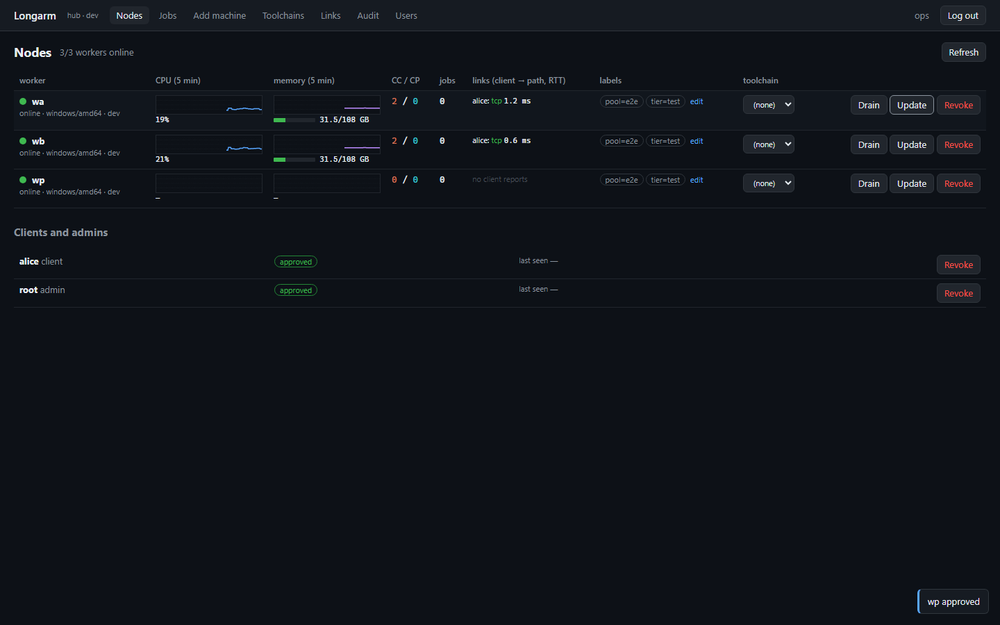
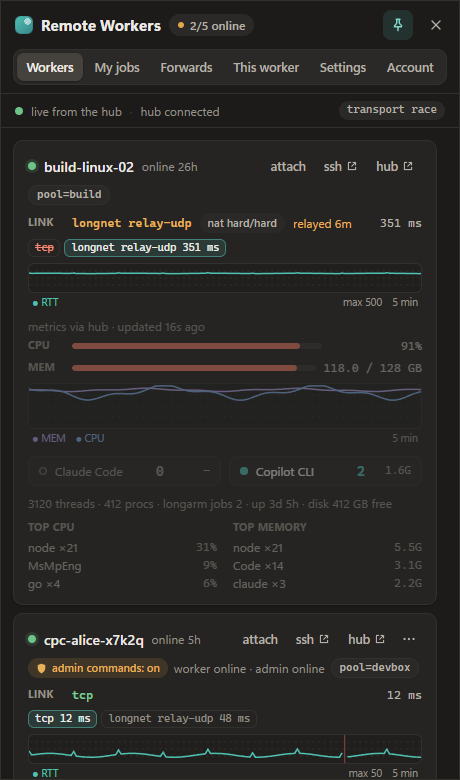

# Longarm

**给你的编程智能体一只长臂。**（Give your coding agents a long arm.）Longarm
把你身边闲置的机器（桌下的工作站、一台旧笔记本、一台云主机）汇聚成一个统一的
worker 池，Claude Code、Copilot CLI 或者你自己都可以在上面运行命令、构建、
测试套件乃至完整的智能体会话——从任何一台笔记本出发，穿透任何 NAT。

[English](README.md) · [使用参考](docs/usage.md) ·
[设计文档](docs/design.md) · [CI/CD](docs/ci-cd.md) · [安全](docs/security.md) ·
[遥测](docs/telemetry.md)

## 为什么需要它

编程智能体很擅长开始干活，却很不擅长等活干完。一次 `pnpm test` 或一次 Rust
构建就能把笔记本的 CPU 占满，再开一个智能体会话负载翻倍，三个并行的子智能体
更是让风扇狂转、电池告急。与此同时，家里那台 32 核的机器和云上的那台虚拟机却
在闲着。

Longarm 让智能体（或者你）可以说一句 *“去那边跑”*：

- **卸载重活**：构建、测试套件、`claude -p` / `copilot -p` 会话都在 worker
  上运行，你的笔记本保持凉爽安静。
- **并行扇出**：每个并行子智能体都能分到自己的 worker 或 worktree，由一个
  知道哪台机器还有空闲内存的调度器来分配。
- **什么都扛得住**：任务在 worker 上以脱离（detached）方式运行。合上笔记本、
  切换网络、重启 worker 守护进程——任务照跑不误，你可以随时重新连接查看输出。
- **哪里都能连**：位于家用路由器和运营商级 NAT（CGNAT）之后的 worker，可以
  通过打洞直连；打洞失败时则走中继。

## 功能特性

- **以服务形式运行的 worker**——`longarmd` 以 Windows 服务、systemd unit 或
  launchd 守护进程的形式，在普通用户账户下运行（这样任务能找到该用户的 git、
  node 和智能体配置）。
- **重启不丢的任务**——每个任务和会话都运行在各自的小型 shim 进程中；守护进程
  崩溃或更新都不会杀掉它们。日志可以从任意字节偏移处开始流式读取，退出码会被
  原样回传。
- **交互式 PTY 会话**——类似 tmux 的 `longarm attach`：命名会话、多客户端同时
  连接，用 `Ctrl-] d` 脱离，重新连接时回放历史输出。程序（IDE、桌面应用）
  无需终端也能驱动同一个会话：`longarm session start|send|stop`。
- **端口转发**——`longarm forward worker-1 3000` 把 worker 上的开发服务器
  映射到你的 `localhost`。
- **worker 之间的端口链接**——`longarm link create backend:8080 --on frontend`
  让你在一个 worker 上的作业以 `127.0.0.1:8080` 访问另一个 worker 的端口，流量在
  worker 之间传输（直连或经 hub 中继，不经过你的电脑；前端和测试在这里，后端在那里），
  每个链接都由 hub 签发授权。
- **代码同步**——`longarm sync .` 把你的工作副本（提交、未提交的修改、未跟踪
  的文件）镜像到 worker 上的一个 git worktree；`longarm run --repo .` 则为
  任务创建一个全新的 worktree（`--ref` 可以是分支、标签或完整的提交 id；Git LFS
  文件默认是指针文件，`--lfs ship` 则一并发送其内容）。
- **内置 sshd**——`ssh`、`scp`、`sftp` 和 VS Code Remote-SSH 都走同一条 mTLS
  通道，无需管理 SSH 密钥。
- **MCP 服务器**——`longarm mcp` 为 Claude Code 和 Copilot CLI 提供
  `fleet_status`、`fleet_exec`、`fleet_job_submit`、`fleet_job_wait`、
  `fleet_sync`、`fleet_forward`、`fleet_link` 等工具。密钥按名称传递，从不经过模型。
- **带内存门槛的调度器**——`longarm run -- make` 会挑选负载最低、且有足够空闲
  内存和 CPU 余量的 worker，按任务类型预留内存，优先选择已有你仓库的 worker，
  没有合适的机器时则排队等待。
- **Hub**——`longarm-hub` 是控制平面：一次性加入码、用于签发 mTLS 证书的内置
  CA（自动续期、可吊销）、节点注册表、全集群任务索引、审计日志、工具链配置、
  安装脚本。它从不处于数据平面上：hub 宕机时，worker 照常工作，客户端直接与
  它们通信。
- **三种传输方式竞速**——每次连接都会同时拨号所有链路，最先完成 mTLS 握手的
  胜出：
  - 普通 **TCP**（局域网、VPN、你自己的 tailnet），
  - **Tailscale**，通过内嵌的 `tsnet` 节点（Tailscale SaaS 或自托管的
    Headscale；hub 签发带标签的一次性密钥，无需安装 `tailscaled`），
  - **longnet**，Longarm 自研的 QUIC 传输，内置 NAT 类型检测、打洞，以及集成
    在 hub 中的中继兜底（UDP 或基于 TCP 的 TLS）。
- **托盘应用与 Web 面板**——`longarm-tray` 实时显示每个 worker 的 CPU/内存、
  你到每个 worker 的链路（直连或中继、RTT）、你的任务和端口转发；hub 的 Web
  面板（TOTP 登录）用于管理节点、任务、加入码和用户。
- **签名自更新**——发布版本使用 minisign 签名；worker 按金丝雀方式先行更新，
  对新版本做健康检查，失败时自行回滚；MSI 安装和客户端则会收到更新提示。
- **安装包**——MSI（Windows）、deb/rpm（Linux）、pkg 和 Homebrew cask
  （macOS），hub 另有 Docker 镜像和 deb 包，并由 hub 提供一行命令安装脚本。

| Hub Web 面板 | 托盘弹窗 |
|---|---|
|  |  |

## 架构

```
  laptop (client)                       hub (small cloud VM)
 ┌───────────────────────┐            ┌──────────────────────────────┐
 │ Claude Code / Copilot │            │ longarm-hub                  │
 │   └─ longarm mcp      │  gRPC/mTLS │  join codes · CA · registry  │
 │ longarm CLI           │◄──────────►│  scheduler · job index       │
 │ longarm daemon (pool, │  (control) │  web panel · release store   │
 │   forwards, latency)  │            │  longnet relay + STUN        │
 │ longarm-tray          │            └──────────────▲───────────────┘
 └──────────┬────────────┘                           │ heartbeats, metrics,
            │                                        │ job reports (control)
            │  data plane: exec, logs, PTY, files,   │
            │  forwards - raced over three legs:     │
            │    tcp · tailscale (tsnet) · longnet   │
            │    (direct after hole punching,        │
            │     else via the relay)                │
            ▼                                        │
 ┌─────────────────────────────────────────────────────────────────┐
 │ workers: longarmd (service)  worker-1 (Windows)  worker-2 (Linux)│
 │   shim per job/session · git mirrors + worktrees · built-in sshd │
 └─────────────────────────────────────────────────────────────────┘
```

Hub 只负责协调。命令、输出、文件和终端都在客户端与 worker 之间直接传输（或经
中继传输，并使用同一套 mTLS 证书做端到端加密）。

## 快速上手

### 加入一个 hub

已经有人在运行 hub（团队的 hub，或发布版本内置的那个）？安装、用 Microsoft
账户登录，就这么简单——不用填 hub 地址，不用加入码，不用核对指纹，也不用输密码。

**1. 安装**：在每台想用的机器上安装。

**Windows：下载 MSI，点两次“下一步”，在浏览器里批准。**
`longarm-windows-amd64.msi` 可以从 hub 的 “Get Longarm” 页面
（`https://hub.example.com/get`）下载，也可以直接从 hub 的发布仓库下载
（`https://hub.example.com/releases/<version>/longarm-windows-amd64.msi`），
或者去 [releases 页面](https://github.com/lubobill1990/longarm/releases)。
运行安装程序，点“下一步”，保持 **Default (recommended)**，选择
“This is my everyday computer: send jobs to workers”（只当客户端用）或
“This machine runs jobs (Dev Box, build machine)”（同时当 worker；在 Dev Box /
Cloud PC 上默认选中），再点“下一步”、“安装”。装完后 Longarm 托盘会自动开始登录
并显示一个验证码：在浏览器里批准即可（第 2 步）。之后想改角色，可以在托盘的
Account 页里改。worker 以你本人的身份运行，只要你处于
登录状态就一直在线（远程桌面断开也不受影响——Dev Box 会保留会话），所以即使
这台机器只能用 Windows Hello 或安全密钥登录、根本没有密码，也照样能用。勾选
“Allow remote administrator commands” 会额外装一个
[管理员 worker](docs/usage.md#admin-worker-windows)，用来跑需要 SYSTEM 权限的
任务。“Custom” 用于连接其他 hub、使用加入码，或把 worker 装成 Windows 服务。
静默安装：`msiexec /i longarm-windows-amd64.msi /qn ROLES=both`（所有属性见
[packaging/windows/longarm.wxs](packaging/windows/longarm.wxs) 开头的注释）。
“Default” 用的 hub 是在构建发布版本时写进去的（仓库变量
`LONGARM_DEFAULT_HUB`，见 [docs/ci-cd.md](docs/ci-cd.md#24-secrets-and-variables)）。

**SmartScreen。** 没有 Authenticode 签名的版本（只有配置好经过验证的 Azure Trusted Signing
证书配置文件后才会签名，见 [docs/ci-cd.md](docs/ci-cd.md#27-authenticode-azure-trusted-signing-windows)），
Windows 会显示"Windows 已保护你的电脑"/"未知发布者"：先用发布页的 `SHA256SUMS` 核对文件
（`Get-FileHash longarm-windows-amd64.msi`），再点 **更多信息 → 仍要运行**。签名的版本会显示发布者；
新版本在积累下载信誉之前 SmartScreen 仍可能提示。自动更新（托盘、Longarm Update 服务）无论是否有
Authenticode 签名，都会校验发布密钥的 minisign 签名。

也可以用一行命令安装——hub 提供的脚本里已经写好了它的地址并固定了 CA：

```sh
curl -fsSL https://hub.example.com/install.sh | sudo sh -s -- --login --role both          # Linux / macOS
$env:LONGARM_LOGIN=1; $env:LONGARM_ROLE='both'; irm https://hub.example.com/install.ps1 | iex   # Windows（以管理员身份运行时使用 MSI）
msiexec /i longarm-windows-amd64.msi /qn MODE=custom ROLES=both HUB=hub.example.com LOGIN=1   # MSI，连接其他 hub
```

已经装好了？运行 `longarmd login hub.example.com --role both` 即可——只需要
hub 的域名：它的 CA 会通过 HTTPS 从 `https://hub.example.com/ca.crt` 获取并固定
（见 [docs/security.md](docs/security.md#first-contact-domain-only-sign-in)）。

**2. 用 Microsoft 账户登录——只需一个验证码。** 安装过程会输出：

```
To link this machine as your device and your worker (one approval for both), sign in with your Microsoft account ...
  Open https://hub.example.com/link and enter code BCDF-GHJK
```

在任意浏览器里打开这个页面（手机也行），用 Microsoft 账户登录，输入验证码，
确认机器名后点批准——客户端和 worker 两个角色一次批准就够了。（MSI 不在控制台
里登录：由它打开的托盘（“Sign in with Microsoft”）或 `longarmd login --role both`
在安装后显示验证码，不需要再输入别的；批准后托盘会显示 “Signed in as ...”、
worker 的状态，以及 Sign out 和 Open panel。）

**3. 这台机器既是你的 worker，也是你的客户端。** 它运行你的任务（在你用
`longarm worker share` 共享之前只有你能用），它上面的 `longarm` 以你的身份操作；
hub 的 Entra 管理员会拿到管理员证书。`longarm ls` 能看到它。可以在登录时给它
打上标签以便调度（`--login --label pool=devbox`、`longarmd login --label pool=devbox`、
MSI 的 `LABELS=pool=devbox`），也可以事后用 `longarm worker label <worker> pool=devbox`
补上，之后 `longarm run --require pool=devbox` 就会把任务派到那里。

longarmd 的数据目录（证书、hub 地址、任务）是其运行账户的 `~/.longarm`——
MSI 默认的用户会话 worker 用的就是你自己的 `~\.longarm`。服务则使用服务账户的
目录（`sudo longarmd service install --user alice` 用 alice 的）；Linux 上以 root
运行时默认为 `/var/lib/longarmd`，Windows 上以 LocalSystem 运行时为
`C:\ProgramData\Longarm\longarmd`（MSI 安装的服务也是这个）；`--data-dir` /
`LONGARM_DATA_DIR` 可覆盖（见 [docs/usage.md](docs/usage.md#data-directory)）。
worker 离线、登录过期、更新提示等问题见
[docs/troubleshooting.md](docs/troubleshooting.md#for-users-common-problems)；
卸载见[卸载](docs/usage.md#uninstall)。

### 自建 hub

你需要一个处处可达的 hub（一台有公网 IP 的小型虚拟机，开放端口 7443/tcp+udp
和 7444/udp）。各平台的二进制文件见
[releases 页面](https://github.com/lubobill1990/longarm/releases)；
也可以用 Go ≥ 1.27.3 从源码构建：`go build -o bin/ ./cmd/...`。

一条命令部署到 Azure（容器实例，约 44 美元/月；详见
[deploy/azure](deploy/azure/README.md)），完成后会打印加入命令：

```sh
az login && cd deploy/azure && ./deploy.sh --name myhub --location eastasia   # 或 deploy.ps1
# --build-in-acr：在 Azure 中从你的代码构建镜像（无需 docker）；或者用按钮：
```

[](https://portal.azure.com/#create/Microsoft.Template/uri/https%3A%2F%2Fraw.githubusercontent.com%2Flubobill1990%2Flongarm%2Fmain%2Fdeploy%2Fazure%2Fazuredeploy.json)

或者部署在任意有公网 IP 的主机上（详见 [deploy/hub](deploy/hub/README.md)）：

```sh
longarm-hub --data-dir /var/lib/longarm-hub ca init        # 集群的 CA
longarm-hub --data-dir /var/lib/longarm-hub serve &        # :7443 gRPC + 中继，127.0.0.1:7480 面板
longarm-hub --data-dir /var/lib/longarm-hub ca show        # CA 指纹
longarm-hub --data-dir /var/lib/longarm-hub join-code --role admin
```

然后按上面的步骤加入（`longarmd login hub.example.com --role both`，或者用一行
命令）。Microsoft 登录需要 hub 配置 `[auth.entra]`（见
[docs/usage.md](docs/usage.md#sign-in-with-microsoft-entra-id)；没有配置时，用面板
账户登录也可以批准验证码）。也可以改用加入码：在你的笔记本上运行
`longarm join hub.example.com:7443 <admin-code> --ca-fingerprint <fp>`，再用
`longarm admin join-code --role worker` 为每台 worker 生成一个加入码；在 worker 上运行
`longarmd join hub.example.com:7443 <code> --ca-fingerprint <fp> --name worker-1`，
然后 `longarm admin approve worker-1`，再 `sudo longarmd service install --user alice`
（Windows 上以管理员身份：`--user .\alice`）+ `longarmd service start`——或者把一行
命令里的 `--login` 换成 `--join <code>`。完全不用 hub：见
[CA 与 `admin issue`](docs/usage.md#advanced-self-hosted-without-sign-in-ca-and-admin-issue)。

### 开始使用

```sh
longarm ls                                     # worker、负载、智能体会话
longarm exec worker-1 -- git --version         # 短命令，退出码原样回传
longarm run --repo . -f -- pnpm test           # 在全新 worktree 中调度任务，并跟踪其输出
longarm attach worker-1 -s agent -- claude     # 可随时脱离的交互式智能体会话
longarm forward worker-1 3000                  # worker 的开发服务器映射到 localhost:3000
longarm link create worker-2:8080 --on worker-1   # worker-1 上你的作业通过 127.0.0.1:8080 访问 worker-2 的 :8080
```

交给你的智能体：

```sh
claude mcp add longarm -- longarm mcp
# Copilot CLI：~/.copilot/mcp-config.json
#   {"mcpServers": {"longarm": {"type": "local", "command": "longarm", "args": ["mcp"], "tools": ["*"]}}}
```

然后直接提问：*“在集群上跑一遍完整测试套件，告诉我哪些失败了”*，或者
*“在不同的 worker 上启动三个子智能体，每个失败的包分配一个”*。

其他内容——不依赖 hub 的 worker、Tailscale/Headscale、中继、托盘应用、自更新、
安装包、防火墙——都在[使用参考](docs/usage.md)中。hub 可以把脱敏后的遥测数据
（错误、崩溃、耗时；不含命令行和名称）发送到 Azure Application Insights；只有在
hub 配置了连接字符串时才会开启，而且每台机器都可以选择退出（`longarm telemetry off`，
见 [docs/telemetry.md](docs/telemetry.md)）。

## 与团队共享一个 hub

多个人可以共享同一个 hub 和它的 worker，而彼此看不到对方的工作（威胁模型和
局限见 [docs/security.md](docs/security.md)）：

```sh
# 在管理员的笔记本上：每人一个用户（可选团队、配额）
longarm admin user add alice --team web --max-jobs 8 --max-mem-gb-per-worker 64 --panel
longarm admin user add bob   --team web
#   -> 每个用户一个加入码；在他们的笔记本上：longarm join hub.example.com:7443 <code> ...
longarm admin user code alice --device alice-desktop   # alice 的另一台设备
longarm admin team ls ; longarm admin user ls          # 设备、用量、配额

# 多人共用的 worker：按用户隔离操作系统账户（以 LocalSystem / root 运行）
sudo longarmd join hub.example.com:7443 <worker-code>   # 数据：/var/lib/longarmd（C:\ProgramData\Longarm\longarmd）
sudo longarmd service install --isolation per-user      # 或 MSI ISOLATION=per-user、
                                                        # deb LONGARM_ISOLATION=per-user
```

- 每个作业、会话、文件、端口转发和镜像都属于创建它的证书所对应的用户。用户只
  能看到自己的作业和会话（`longarm jobs`、面板的 “My jobs”、MCP 工具），管理员
  能看到全部；`longarm run --share team -- ...` 让团队成员可以读取作业输出。
- 在 `[isolation] mode = "per-user"` 的 worker 上，每个用户的作业、会话、shell、
  `exec`、文件传输和 git 都以该用户专属的本地账户（`la-alice`）运行：即使在自己的
  作业里也读不到别人的文件、代码、日志、密钥和进程内存，端口转发也只能到达自己
  的开发服务器。支持 Windows 和 Linux；macOS worker 保持共享模式。
- 配额（活动作业数、预留内存——全集群和单个 worker——会话数、单作业内存/CPU
  限制）由调度器和每个 worker 执行。`longarm admin user disable|remove [--purge]`
  可以停用用户（并在 worker 上删除其数据和账户）。

## 安全模型

- **全程 mTLS。** 每个节点都持有一张由集群自有 CA 签发的证书，身份为
  `longarm://<role>/<name>`（角色：admin、client、worker、hub、relay、
  release）。Worker 按角色对每一次调用进行授权；数据平面上不存在密码或共享
  密钥。
- **注册**使用短时效的一次性加入码，并固定（pin）CA 指纹；除非 hub 开启了自动
  审批，新的 worker 需要等待审批。证书自动续期且可吊销；吊销列表会随下一次心跳
  下发到每台 worker。
- **Hub 永远看不到你的数据。** 它负责协调，但不在数据路径上；中继转发的是不透明
  的、端到端加密的数据包。
- **Worker 之间互无权限。** 端口链接只允许一个 worker 连接另一个 worker 的某一个
  端口，凭的是 hub 为该链接签发的授权，除此之外别无其他
  （见 [security.md](docs/security.md#port-links)）。端口转发只能到达 worker 自己的
  回环端口，除非设置了 `[forward] targets = "any"`。
- **任务以 worker 的服务账户身份运行**，而不是 SYSTEM/root（除非你明确这样
  选择）；多人共用的 worker 上则以每个用户各自的本地账户运行
  （见[多租户](docs/security.md)）。请把每个拥有 `client` 角色的客户端都视为能在
  其可达的 worker 上执行任意代码——这正是这个工具的用途。彼此完全不信任的用户
  请使用不同的集群（CA）或虚拟机。
- **密钥**（`--secret-env`）通过 mTLS 传输，只存在于任务的内存和环境变量中，
  并会在日志中被脱敏。MCP 服务器只转发运维人员加入白名单的密钥
  （`LONGARM_MCP_SECRETS`）。
- **本地控制 API** 使用命名管道 / unix socket，仅所有者可读。
- **更新**经过签名（minisign），并用内置于二进制文件中的公钥校验；CI 的凭据
  可以发布和推送更新，但无法降级。

漏洞报告方式见 [SECURITY.md](SECURITY.md)。

## 现状与限制

Longarm 还很年轻。它已在一个小型混合集群（Windows、Linux、macOS worker）上
日常承载智能体工作负载，并在三个平台上都有完善的端到端测试套件（真实进程、
真实 socket）——但仍可能遇到一些粗糙之处，且配置格式在 1.0 之前可能会变化。

- 集群面向一个团队或一个人设计：几十台 worker，而不是几千台。只有一个 hub，
  没有高可用（它不在数据路径上，所以 hub 宕机只会暂停调度和注册）。
- Worker 是受信任的机器：除操作系统账户（服务账户，或开启按用户隔离时每人一个
  账户；它能隔离什么、不能隔离什么见 [docs/security.md](docs/security.md)）外没有
  额外的沙箱。不受信任的代码请自行放在虚拟机或容器中运行。
- Linux 上的托盘应用需要 GTK 4 + WebKitGTK 6（或使用构建标签切换到 GTK 3）；
  macOS 安装包必须在 Mac 上签名和公证。
- 打洞无法穿透所有 NAT；两端都处于对称型 NAT 之后时，连接会保持走中继。

## 参与贡献

欢迎提交 issue 和 pull request——请参阅 [CONTRIBUTING.md](CONTRIBUTING.md)。
`go test ./...` 会在 Windows、Linux 和 macOS 上运行单元测试和端到端测试。

## 许可证

[MIT](LICENSE)。Claude Code 是 Anthropic 的产品，Copilot CLI 是 GitHub 的产品；
Longarm 是一个独立项目，与二者均无关联。
